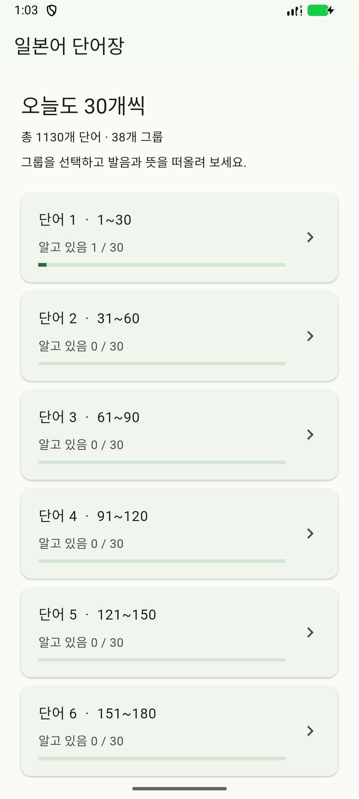
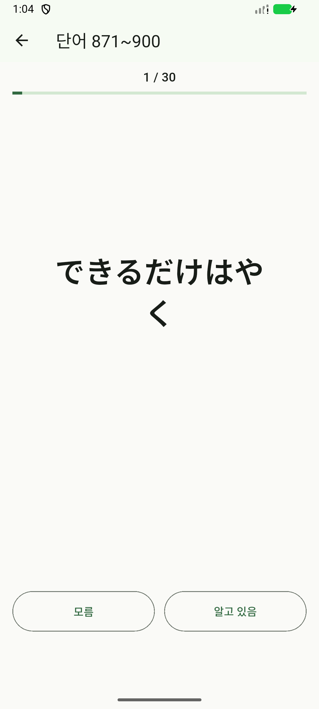
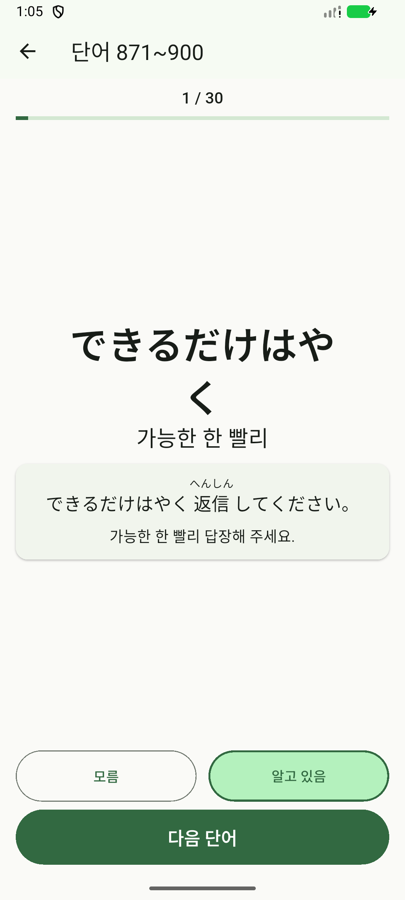

# 일본어 단어장 · JLPT N1

일본어 단어와 표현을 **30개씩, 오프라인으로** 공부하는 Flutter 앱입니다. 한자와 가나를 보고 뜻을 떠올린 뒤, 예문으로 쓰임을 확인할 수 있습니다.

현재 **1,130개 단어 · 38개 세트**를 제공합니다. 서버나 로그인 없이 학습 기록을 휴대폰에 저장합니다.

## 앱 화면

| 세트별 학습 진행도 | 단어 문제 | 정답과 예문 |
| :---: | :---: | :---: |
|  |  |  |

*Android 1.3.0 실제 실행 화면입니다.*

## 주요 기능

- **랜덤 학습**: 세트에 들어갈 때마다 순서를 섞고, 한 회차에 모든 단어를 한 번씩 출제합니다.
- **알고 있음 / 모름**: 응답하면 발음·뜻·예문을 공개하고, 별도의 ‘다음 단어’ 버튼으로 넘어갑니다.
- **후리가나 예문**: 모든 단어에 짧은 일본어 예문과 한국어 해석을 제공합니다.
- **진행도 저장**: 마지막 응답을 기준으로 진행바를 채우고, 세트의 모든 단어를 알면 ‘학습 완료’를 표시합니다.
- **한 화면에서 학습**: 정답 공개 전후 문제와 버튼 위치를 유지하고, 스크롤 없이 예문까지 확인합니다.

## Android 설치

[**1.3.0 APK 다운로드**](https://github.com/OverWindow/JLPT_N1/raw/refs/heads/main/releases/jlpt-1.3.0.apk)

휴대폰에서 APK를 내려받아 열면 설치할 수 있습니다. 기존 앱은 삭제하지 않고 덮어 설치하면 학습 기록이 유지됩니다. Android 7.0 이상을 지원합니다.

iOS 프로젝트도 포함되어 있으나, 설치용 빌드는 macOS와 Xcode에서 별도로 진행해야 합니다. Windows에서는 iOS 빌드를 검증하지 않았습니다.

## 개발 및 실행

Flutter 3.47.1 / Dart 3.13.1 기준입니다.

```sh
flutter pub get
flutter run
```

```sh
flutter analyze
flutter test
flutter test integration_test/app_test.dart -d emulator-5554
flutter build apk
```

정적 분석, 단위·화면 테스트 34개, Android 오프라인 통합 테스트와 기존 버전 위에 덮어 설치 시 기록 보존을 확인했습니다.

- 앱 데이터: [`assets/words/words.json`](assets/words/words.json)
- 전사·병합 기록: [`data/README.md`](data/README.md)
- 상세 구현 및 검증 안내: [`docs/development.md`](docs/development.md)

원본 단어 사진이 있는 `image/` 폴더는 `.gitignore`로 제외합니다. README의 앱 화면은 별도의 `docs/screenshots/`에 보관합니다.
