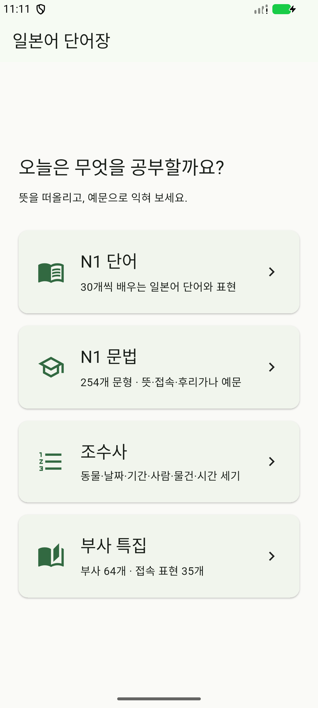
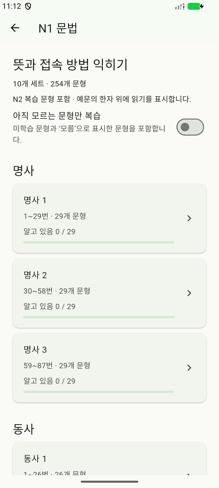
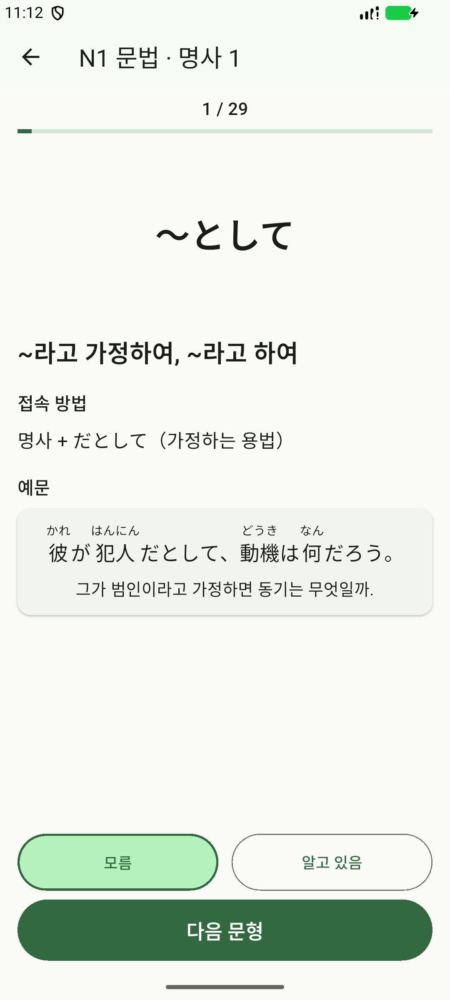

# 일본어 단어장 · JLPT N1

일본어 단어·문법·숫자 세기·부사와 접속 표현을 **오프라인으로** 공부하는 Flutter 앱입니다. 첫 화면에서 **N1 단어 / N1 문법 / 조수사 / 부사 특집** 중 하나를 선택하고, 한자를 보고 읽기와 뜻을 떠올린 뒤 예문으로 쓰임을 확인합니다.

**N1 단어 1,342개·45세트**, **N1 문법 254개·10세트**, **조수사 270개 표현·17세트**, **부사 특집 99개 표현·8세트**를 제공합니다. 서버나 로그인 없이 네 학습 기록을 각각 휴대폰에 저장합니다.

## 앱 화면

| 첫 화면 | N1 문법 세트 | 뜻·접속·예문 |
| :---: | :---: | :---: |
|  |  |  |

*Android 1.7.0 실제 실행 화면입니다.*

## 주요 기능

- **랜덤 학습**: 세트에 들어갈 때마다 순서를 섞고, 한 회차에 모든 단어를 한 번씩 출제합니다.
- **알고 있음 / 모름**: 응답하면 발음·뜻·예문을 공개하고, 별도의 ‘다음 단어’ 버튼으로 넘어갑니다.
- **후리가나 예문**: 모든 단어에 짧은 일본어 예문과 한국어 해석을 제공합니다.
- **진행도 저장**: 마지막 응답을 기준으로 진행바를 채우고, 세트의 모든 단어를 알면 ‘학습 완료’를 표시합니다.
- **고정된 문제와 버튼**: 정답 공개 전후 위치를 유지합니다. 단어·조수사·부사는 한 화면에 표시하고, 문법의 긴 정답은 스크롤하여 읽습니다.

조수사는 **동물·날짜·기간·사람·물건·시간**으로 나눕니다. 숫자도 `三匹`, `二十日`, `六本`처럼 한자로 출제하며, ‘모름 / 알고 있음’을 누르면 읽기·뜻·예문이 나타납니다. 날짜와 기간의 `一日`은 따로 학습하고, 복수 읽기가 있는 표현은 대체 읽기도 제공합니다.

부사 특집은 새 사진 11장의 **부사 64개와 접속 표현 35개**를 담았습니다. 부사는 30·30·4개, 접속 표현은 순접·병렬/선택·역접·전환/환언·첨가/보충으로 나눕니다. 모든 항목에 짧은 창작 예문과 후리가나·한국어 해석을 제공합니다.

N1 문법은 사진 68장의 번호별 문형 254개를 **명사 87개·동사 76개·명사와 동사 32개·여러 품사 59개**로 정리했습니다. 각 문형에 한국어 뜻, 접속 방법, 후리가나 예문과 해석을 제공합니다. N2 복습 문형도 포함하며, **아직 모르는 문형만 복습**으로 미학습·모름 항목만 다시 공부할 수 있습니다.

## Android 설치

[**1.7.0 APK 다운로드**](releases/jlpt-1.7.0.apk)

1.7.0은 N1 문법 메뉴와 254개 문형을 추가했습니다. 기존 N1 단어 1,342개, 조수사 270개, 부사 특집 99개와 각 학습 기록을 유지합니다.

휴대폰에서 APK를 내려받아 열면 설치할 수 있습니다. 기존 앱은 삭제하지 않고 덮어 설치하면 학습 기록이 유지됩니다. Android 7.0 이상을 지원합니다.

iOS 프로젝트도 포함되어 있으나, 설치용 빌드는 macOS와 Xcode에서 별도로 진행해야 합니다. Windows에서는 iOS 빌드를 검증하지 않았습니다.

## 개발 및 실행

Flutter 3.47.1 / Dart 3.13.1 기준입니다.

```sh
flutter pub get
flutter run
```

```sh
flutter analyze
flutter test
flutter test integration_test -d emulator-5554
flutter build apk
```

정적 분석과 단위·화면 테스트 61개, Android 문법 통합 테스트 1개가 통과했습니다. 254개 전 항목을 3개 화면 크기·글씨 2배에서 검사했으며, 문법 저장·복원과 1.6.0 위에 덮어 설치 시 기존 세 학습 기록 보존을 확인했습니다.

- 앱 데이터: [`assets/words/words.json`](assets/words/words.json)
- 조수사 데이터와 읽기 근거: [`data/counters/README.md`](data/counters/README.md)
- 부사 특집 전사·용법·재생성: [`data/adverbs/README.md`](data/adverbs/README.md)
- 문법 자료·재생성: [`data/grammar/README.md`](data/grammar/README.md)
- 전사·병합 기록: [`data/README.md`](data/README.md)
- 상세 구현 및 검증 안내: [`docs/development.md`](docs/development.md)

원본 단어 사진이 있는 `image/` 폴더는 `.gitignore`로 제외합니다. README의 앱 화면은 별도의 `docs/screenshots/`에 보관합니다.
